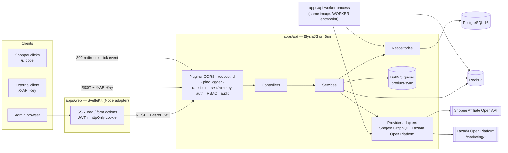
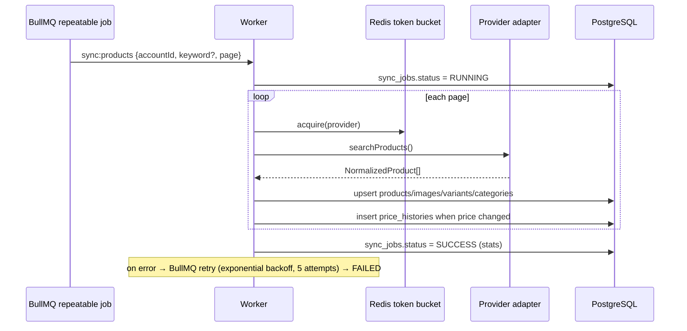

# Architecture — Shopee & Lazada Affiliate Data Service

## 1. System overview



Key rules:

* **The browser never talks to PostgreSQL or the marketplaces.** SvelteKit calls the API from server code only; the admin JWT lives in an `httpOnly` cookie and is never exposed to client JS.
* **Provider credentials** (Shopee AppID/Secret, Lazada app_key/app_secret/userToken) are stored AES‑256‑GCM encrypted in `affiliate_accounts.credentials_enc`; the API never returns them (responses expose only `hasCredentials`).
* **Layers:** `controller` (HTTP + validation via TypeBox) → `service` (business rules, cache, queue) → `repository` (Prisma only) → `provider` (marketplace HTTP only).
* **Worker isolation:** `src/worker.ts` runs the BullMQ `Worker` in a separate process so long syncs don't block HTTP.

## 2. Library compatibility with Bun (verified Nov 2026)

| Concern | Choice | Why |
|---|---|---|
| HTTP | Elysia 1.4 | Bun-native. |
| Validation | TypeBox 0.34 (`@sinclair/typebox`) | Same engine as Elysia's `t`; schemas live in `packages/shared` and are reused by SvelteKit. |
| OpenAPI | `@elysiajs/openapi` 1.4 | `@elysiajs/swagger` is superseded for Elysia 1.4; serves Scalar/Swagger UI at `/docs`. |
| ORM | Prisma 6.19 (`prisma-client-js`) | Runs on Bun with the default query engine; Prisma 7/8 move to mandatory driver adapters (a bigger, still-changing surface), so we pin 6.x. |
| Queue | BullMQ 5 + ioredis 5 | BullMQ runs its full test suite on Bun in CI (bullmq.io). ioredis is BullMQ's default client. Bun's built-in `RedisClient` lacks Cluster/Sentinel, so we keep ioredis. |
| Logging | pino 9 | Structured JSON; works on Bun (no worker-thread transports used in prod). |
| JWT | `jose` 6 | Pure Web Crypto, no native deps. |
| Password hash | `Bun.password` (argon2id) | Built in. |
| Encryption | `node:crypto` AES-256-GCM | Fully implemented in Bun. |

## 3. Marketplace API facts used (and how they were verified)

### Lazada — verified from official docs at open.lazada.com (rendered Nov 2026)
* Gateways: `https://api.lazada.{vn,sg,com.ph,com.my,co.th,co.id}/rest`.
* Common params: `app_key`, `timestamp` (ms), `sign_method=sha256`, `sign`, optional `access_token`.
* Signature: sort all params by ASCII name, concatenate `key+value`, prefix API path, HMAC‑SHA256 with app secret, **uppercase hex**.
* `GET|POST /marketing/product/feed` — `offerType` (1 normal, 2 MM), `categoryL1?`, `mmCampaignId?`, `limit`, `page`, `userToken`, `productIds?`, `dmInviteId?`. Response `result.data[]` with `productId, productName, pictures, discountPrice, currency, brandName, sellerName, categoryL1, totalCommissionRate, sales7d, stock, outOfStock, mmCampaign*` …
* `GET|POST /marketing/getlink` — `userToken`, `inputType` (productId/url/offerId), `inputValue` (comma separated), `subId1..6`, `subAffId`, `mmCampaignId`, `dmInviteId`, `subIdKey`. Response `result.data.product_batch_get_link_info_list[].regular_promotion_link` / `url_batch_get_link_info_list`.

### Shopee Affiliate Open API — docs are behind the affiliate dashboard login
* What is confirmed from a published client implementation: GraphQL `POST https://open-api.affiliate.shopee.<tld>/graphql`, header
  `Authorization: SHA256 Credential={AppId}, Signature={sha256hex(AppId + Timestamp + Payload + Secret)}, Timestamp={unixSeconds}`,
  and `mutation { generateShortLink(input:{originUrl, subIds}) { shortLink } }`.
* `productOfferV2` field names are taken from Shopee's dashboard documentation and are isolated in
  `apps/api/src/providers/shopee/queries.ts`; responses are validated at runtime so a schema drift fails the sync job loudly instead of writing bad data. **Verify these against your dashboard's "Open API → Document" page before going live.**
* The endpoint is configured per account (no hard-coded region).

## 4. Data flow — scheduled sync



## 5. Click tracking flow

`GET /r/:shortCode` → lookup `affiliate_links` (Redis cached) → insert `click_events` (hashed IP, UA, referer) asynchronously → `302` to provider `short_link`.

## 6. PostgreSQL ER diagram

```mermaid
erDiagram
  users ||--o{ api_keys : owns
  users ||--o{ api_logs : performs
  affiliate_providers ||--o{ affiliate_accounts : has
  affiliate_providers ||--o{ products : lists
  affiliate_providers ||--o{ categories : defines
  affiliate_accounts ||--o{ affiliate_links : generates
  affiliate_accounts ||--o{ campaigns : runs
  affiliate_accounts ||--o{ sync_jobs : syncs
  categories ||--o{ categories : parent
  products ||--o{ product_images : has
  products ||--o{ product_variants : has
  products ||--o{ product_categories : in
  categories ||--o{ product_categories : contains
  products ||--o{ affiliate_links : promoted_by
  products ||--o{ price_histories : tracked
  products ||--o{ promotions : discounted
  campaigns ||--o{ affiliate_links : groups
  affiliate_links ||--o{ click_events : receives
  api_keys ||--o{ api_logs : authenticates

  users { uuid id PK; citext email UK; text password_hash; user_role role; bool is_active; timestamptz last_login_at }
  api_keys { uuid id PK; uuid user_id FK; text name; text prefix UK; text key_hash UK; text[] scopes; int rate_limit_per_min; timestamptz expires_at; timestamptz revoked_at }
  affiliate_providers { uuid id PK; marketplace code UK; text name; text base_url; int rate_limit_per_sec; bool is_enabled; jsonb settings }
  affiliate_accounts { uuid id PK; uuid provider_id FK; text name; text region; text endpoint; text credentials_enc; account_status status; jsonb settings }
  categories { uuid id PK; uuid provider_id FK; text external_id; uuid parent_id FK; text name; text slug; int level }
  products { uuid id PK; uuid provider_id FK; text external_id; text name; numeric price; numeric original_price; numeric discount_rate; numeric commission_rate; numeric commission_amount; char currency; numeric rating; int sales_count; tsvector search_vector; jsonb raw }
  product_images { uuid id PK; uuid product_id FK; text url; int position }
  product_variants { uuid id PK; uuid product_id FK; text external_id; text name; numeric price; jsonb attributes }
  product_categories { uuid product_id PK,FK; uuid category_id PK,FK }
  campaigns { uuid id PK; uuid account_id FK; text name; text code; campaign_status status; numeric budget; timestamptz starts_at; timestamptz ends_at }
  affiliate_links { uuid id PK; uuid account_id FK; uuid product_id FK; uuid campaign_id FK; text origin_url; text short_link; text short_code UK; text[] sub_ids; int click_count }
  price_histories { uuid id PK; uuid product_id FK; numeric price; numeric original_price; numeric discount_rate; numeric commission_rate; timestamptz recorded_at }
  promotions { uuid id PK; uuid product_id FK; text type; text name; numeric discount_rate; timestamptz starts_at; timestamptz ends_at }
  sync_jobs { uuid id PK; uuid account_id FK; sync_type type; sync_status status; jsonb params; jsonb stats; int attempts; text error; timestamptz started_at; timestamptz finished_at }
  click_events { uuid id PK; uuid link_id FK; text ip_hash; text user_agent; text referer; text country; jsonb sub_ids; timestamptz created_at }
  api_logs { uuid id PK; uuid user_id FK; uuid api_key_id FK; text method; text path; int status; int duration_ms; text action; jsonb metadata; timestamptz created_at }
```

### Index strategy

| Table | Index | Type | Purpose |
|---|---|---|---|
| products | `search_vector` | GIN | full-text search (`simple` config — works for Thai tokens split by spaces, plus trigram fallback) |
| products | `name gin_trgm_ops` | GIN (pg_trgm) | fuzzy/ILIKE search for Thai (no word boundaries) |
| products | `(provider_id, external_id)` | unique B-tree | idempotent upsert |
| products | `(provider_id, price)`, `(provider_id, commission_rate DESC)`, `(provider_id, discount_rate DESC)` | composite B-tree | marketplace + filter/sort |
| price_histories | `(product_id, recorded_at DESC)` | composite | chart queries |
| click_events | `(link_id, created_at DESC)`, BRIN on `created_at` | composite / BRIN | analytics range scans |
| api_logs | BRIN `created_at`, `(user_id, created_at)` | | audit search |
| sync_jobs | `(status, created_at DESC)`, `(account_id, created_at DESC)` | composite | dashboard |
| affiliate_links | `short_code` unique, `(account_id, created_at DESC)` | | redirect + history |
| products | `raw` | GIN `jsonb_path_ops` | ad-hoc attribute queries |
