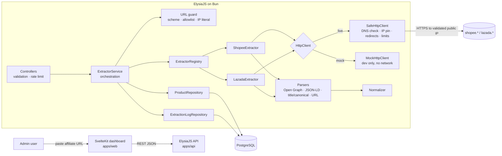
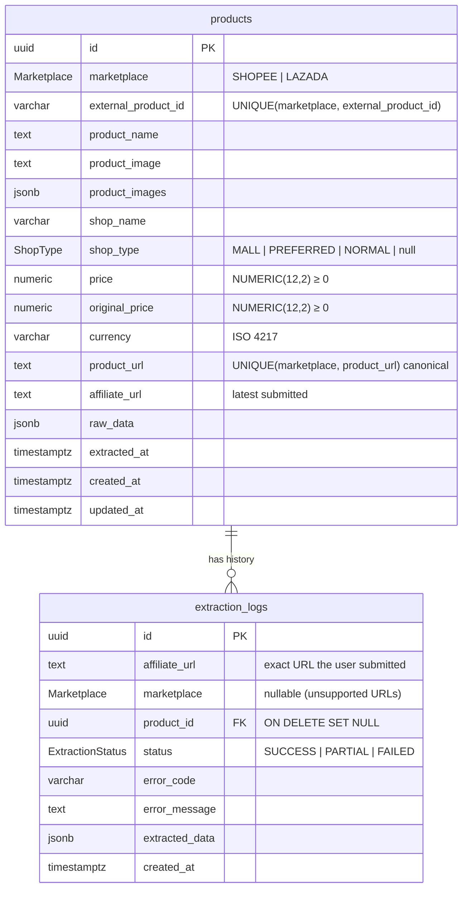

# Architecture — Affiliate Product Extractor

## 1. System architecture



**Layers**

| Layer | Location | Responsibility |
|---|---|---|
| Controller | `src/modules/*/*.controller.ts` | HTTP routing, schema validation (Elysia `t`), Swagger docs, rate limit |
| Service | `src/modules/*/*.service.ts` | Use-case orchestration, transactions, mapping errors to logs |
| Repository | `src/modules/*/*.repository.ts` | Prisma queries only |
| Provider | `src/extractors/**` | Marketplace adapters, data sources, normalisation |
| Security | `src/security/**` | URL guard, IP classification, SSRF-safe fetch, rate limiter |
| Shared types | `packages/shared` | DTOs, enums and error codes shared by API and dashboard |

## 2. Extract → auto-save sequence

```mermaid
sequenceDiagram
  participant UI as Dashboard
  participant API as POST /api/v1/extractor
  participant G as URL guard
  participant X as Shopee/Lazada extractor
  participant F as SafeHttpClient
  participant DB as PostgreSQL

  UI->>API: { affiliateUrl }
  API->>API: rate limit (per IP)
  API->>G: validate scheme, credentials, port, host allowlist
  G-->>API: marketplace
  API->>X: extract(url)
  loop each hop (≤ FETCH_MAX_REDIRECTS)
    X->>F: GET
    F->>F: allowlist host · resolve DNS · all IPs public? · pin IP
    F-->>X: 3xx → re-validate Location
  end
  F-->>X: final HTML (size-limited, timeout)
  X->>X: detect login/CAPTCHA wall → PROVIDER_ACCESS_DENIED (never bypassed)
  X->>X: parse IDs from URL · OG · JSON-LD · title · normalise
  X-->>API: ExtractedProduct
  API->>DB: BEGIN; find duplicate (ext id → canonical URL); update non-null fields OR insert; insert log; COMMIT
  Note over API,DB: P2002 unique violation (race) → retry transaction → update path
  API-->>UI: success | partial | failed (+ log id)
```

Failures at any stage write a `FAILED` row to `extraction_logs` with `error_code`, `error_message` and the stage.

## 3. ER diagram



**Indexes**: `products(created_at DESC)`, `products(marketplace, shop_type)`, GIN trigram on `product_name` and `shop_name` (search), `extraction_logs(created_at DESC)`, `(status)`, `(product_id)`, `(marketplace)`.

## 4. Duplicate detection

1. `(marketplace, external_product_id)` — IDs come from the product URL path and are region-scoped (`TH:shopId.itemId` for Shopee, `TH:itemId` for Lazada) so the same numeric ID in two countries never collides.
2. `(marketplace, product_url)` — canonical URL with tracking params stripped.

On a match, the row is updated **only with non-null values** (existing data is never replaced by `null`), `affiliate_url` becomes the latest submitted URL, and a new log row records the exact affiliate URL used. Both lookups are backed by unique constraints, so concurrent requests for the same product cannot create two rows: the losing transaction gets `P2002`, is retried, and takes the update path.

## 5. Extraction strategy and status

Field values are merged in priority order — the first source that yields a valid normalised value wins:

1. **Authorised source** (`AuthorizedProductSource`, e.g. official affiliate API) — interface only, see README §Limitations
2. **Open Graph** (`og:title`, `og:image`, `product:price:*`)
3. **JSON-LD** schema.org `Product` (name, image, offers price/currency, seller)
4. **HTML** — only `<title>` and `<link rel=canonical>`
5. **URL** — product IDs, and the slug as a last-resort name

| Status | Rule |
|---|---|
| `SUCCESS` | name + verifiable product URL + price + image |
| `PARTIAL` | name + verifiable product URL, but price or image missing, or the name only came from the URL slug |
| `FAILED` | anything else; nothing is saved to `products` |

`shop_type` is only set when a source states it explicitly. Page metadata does not reliably expose Mall / Preferred status, so it stays `null` unless edited manually or supplied by an authorised source.

## 6. SSRF protection

| Control | Where |
|---|---|
| Only `http`/`https`, no credentials, default ports only, no IP-literal or `localhost`/`.local`/`.internal` hosts | `url-guard.ts` (`assertSafeUrlShape`) — every hop |
| Marketplace domain allowlist (exact or subdomain match) | `marketplaces.ts` — every hop |
| DNS resolved by the API; **every** returned address must be globally routable unicast (blocks loopback, RFC1918, ULA, link-local, CGNAT, metadata IPs, multicast, reserved, IPv4-mapped IPv6) | `ip.ts`, `safe-fetch.ts` |
| DNS-rebinding defence: the connection is made to the **validated IP**, with SNI and certificate verification against the original hostname | `pinnedIpTransport` |
| Redirects followed manually, re-validated and re-resolved on each hop, depth-limited | `safeFetch` |
| Overall timeout, streamed body size cap | `safeFetch` |
| Per-IP sliding-window rate limit on the extractor endpoint | `rate-limit.ts` |
| Honest User-Agent; login walls, CAPTCHA and anti-bot pages are detected and reported, never bypassed | adapters |
